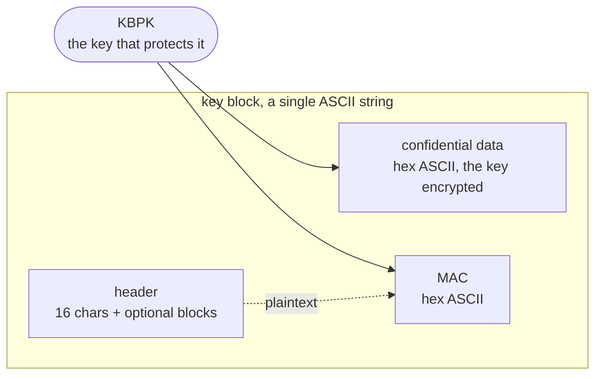
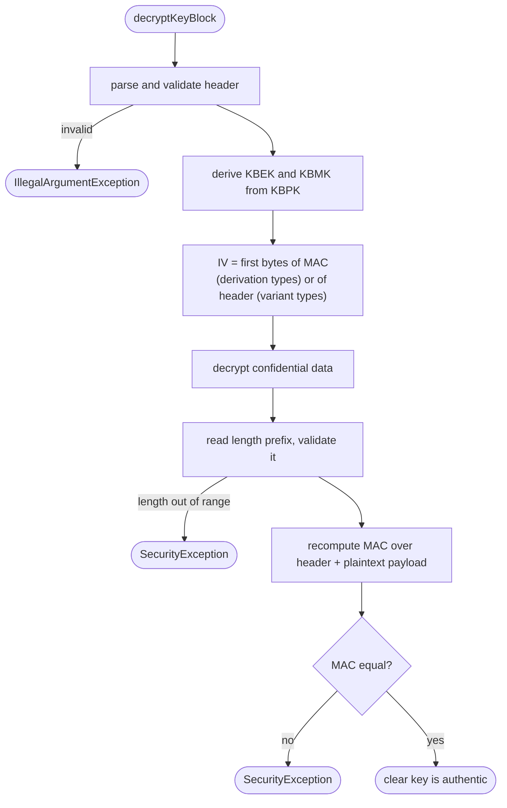

# TR31Keyblock usage guide

How to wrap and unwrap keys with this library, with runnable examples for every feature.

- [Quick start](#quick-start)
- [How a key block works](#how-a-key-block-works)
- [Creating a key block](#creating-a-key-block)
- [Unwrapping a key block](#unwrapping-a-key-block)
- [Padding and key length obfuscation](#padding-and-key-length-obfuscation)
- [Optional blocks](#optional-blocks)
- [Asymmetric keys and certificates](#asymmetric-keys-and-certificates)
- [Choosing a key block type](#choosing-a-key-block-type)
- [Type E and ISO 20038](#type-e-and-iso-20038)
- [Test helpers](#test-helpers)
- [Error handling](#error-handling)
- [Security notes](#security-notes)

All examples are Java and assume these imports:

```java
import at.favre.lib.bytes.Bytes;
import org.keyblock.tr31.*;
```

## Quick start

Wrapping, that is protecting a key with a KBPK:

```java
String kbpk = "88E1AB2A2E3DD38C1FA039A536500CC8A87AB9D62DC92C01058FA79F44657DE6";
String clearKeyHex = "3F419E1CB7079442AA37474C2EFBF8B8";

Header header = new Header(
        KeyblockType._D_AES_KEY_DERIVATION,
        KeyUsage._P0_PIN_ENCRYPTION,
        Export.N_NON_EXPORTABLE,
        Algorithm._A_AES,
        KeyUseFor.E_ENCRYPT_ONLY,
        "00");

TR31KeyBlock kb = new TR31KeyBlock(header);
kb.setKBPK(kbpk);
kb.setClearKey(Bytes.parseHex(clearKeyHex));
kb.generate();

String keyBlock = kb.toString();   // header ASCII + confidential data hex + MAC hex
```

Unwrapping, that is recovering a key from a key block:

```java
TR31KeyBlock kb = new TR31KeyBlock();
kb.decryptKeyBlock(keyBlock, kbpk);

Bytes key = kb.getClearKey();
String keyHex = kb.getClearKey().encodeHex();
```

`decryptKeyBlock` throws if the KBPK is wrong or the block has been tampered with, so reaching the
line after it means the key is authentic.

## How a key block works

A key block carries one protected key. It has three parts:



The KBPK is never stored in the block. Everything else is derived from it, which is why a key block
can only be opened by whoever holds the KBPK.

Three different key block types use three different constructions for the confidential data and
the MAC. Type A, C and the Thales types 0 and 1 are **encrypt then MAC**: the IV comes from the
header and the MAC covers the encrypted data. Types B, D and E are **MAC then encrypt**: the MAC
is computed over the plaintext payload first and is then used as the IV, so the MAC value is
recoverable before decryption.



Every step fails loudly. Nothing is logged-and-continued, and no failure is downgraded to an empty
result, because a caller that cannot tell a bad KBPK from a tampered block cannot make a safe
decision with the key.

## Creating a key block

### Step by step

```java
Header header = new Header(
        keyblockType,     // which protection method
        keyUsage,         // KeyUsage._P0_PIN_ENCRYPTION, _B0_..., _S0_...
        exportability,    // Export.N_NON_EXPORTABLE, _E_..., _S_...
        algorithm,        // Algorithm._A_AES, _T_TRIPLE_DES, _R_RSA, ...
        keyUseFor,        // KeyUseFor.E_ENCRYPT_ONLY, X_DERIVE_OTHER_KEYS, ...
        "00");            // two character key version number

TR31KeyBlock kb = new TR31KeyBlock(header);
kb.setKBPK(kbpkHex);
kb.setClearKey(Bytes.parseHex(clearKeyHex));
kb.generate();
String keyBlock = kb.toString();
```

The KBPK length has to suit the key block type. A type A, B or C block takes a 16 or 24 byte TDEA
KBPK; types D and E take a 16, 24 or 32 byte AES KBPK.

### Doing it properly in production

The default padding is zero filled so that the published example vectors reproduce. Anything that
is not a test should also obfuscate the key length and use random padding:

```java
TR31KeyBlock kb = new TR31KeyBlock(header);
kb.setPaddingDataSource(new SecureRandomPaddingDataSource());
kb.setKBPK(kbpkHex);
kb.setClearKey(Bytes.parseHex(clearKeyHex));
kb.enforceKeyLengthObfuscationPadding();   // pad the key out to its algorithm maximum
kb.generate();
```

See [padding and key length obfuscation](#padding-and-key-length-obfuscation) for what each call
does.

### Regenerating after a change

`generate()` can be called more than once. Change the key or the padding and generate again and
the new values are used, including the declared length in the header:

```java
kb.setClearKey(Bytes.parseHex(otherKeyHex));
kb.generate();     // produces a block for otherKeyHex, and declares its own length
```

## Unwrapping a key block

```java
TR31KeyBlock kb = new TR31KeyBlock();
kb.decryptKeyBlock(keyBlock, kbpkHex);

Bytes key           = kb.getClearKey();          // the protected key
Bytes padding       = kb.getClearKeyPadding();   // whatever followed it in the payload
Bytes mac           = kb.getMessageMAC();        // the recomputed MAC
Header header       = kb.getHeader();            // parsed header, with the optional blocks
KeyblockType type   = header.getKeyBlockType();
```

### Validating optional block data

The header structure is always validated. Checking that the *data* of each optional block matches
the character format the standard requires is opt in:

```java
kb.decryptKeyBlock(keyBlock, kbpkHex);           // structure only, the default
kb.decryptKeyBlock(keyBlock, kbpkHex, true);     // also check each optional block's data format
```

Strict mode is off by default because real key blocks do not always comply: the example published
in ANSI X9.143:2021 section 8.2 has a `KS` optional block whose data is not hexadecimal, and blocks
produced by HSMs are known to do the same. Turn it on when the sender is not trusted and rejecting
a non-conforming block is better than unwrapping it.

Note that turning header validation on also means a key block whose reserved field is not `00`, or
which repeats an optional block ID, is now rejected where it previously parsed. Both are disallowed
by A.5.6, but check any stored blocks you still need to unwrap before upgrading.

## Padding and key length obfuscation

Three separate things are often confused for one another.

**Block padding** is what makes the confidential data a whole number of cipher blocks. It is applied
automatically during `generate()` and never during unwrapping, because the payload arrives whole.

**Key length obfuscation padding** is what hides how long the key is. X9.143 requires a symmetric
key to be padded out to the maximum length for its algorithm, so a 16 byte AES key looks the same
size on the wire as a 32 byte one. `enforceKeyLengthObfuscationPadding()` does this and **refuses**
to run for an algorithm it is not defined for, rather than silently emitting a block that discloses
the key length.

```java
kb.enforceKeyLengthObfuscationPadding();   // AES 16/24 -> 32 bytes, TDEA 16 -> 24 bytes
```

**Padding data** is the actual bytes used for both. `setPaddingDataSource` controls it:

```java
kb.setPaddingDataSource(new SecureRandomPaddingDataSource());  // default is ZeroPaddingDataSource
```

To supply the padding yourself, which is how the published examples are reproduced:

```java
kb.setClearKeyPadding(Bytes.parseHex("1C2965473CE206BB855B01533782"));
```

## Optional blocks

Optional blocks carry metadata in the header, which is authenticated by the MAC. They are added
before the key is set, and the padding block is added for you.

```java
Header header = new Header(KeyblockType._D_AES_KEY_DERIVATION, KeyUsage._P0_PIN_ENCRYPTION,
        Export.N_NON_EXPORTABLE, Algorithm._A_AES, KeyUseFor.E_ENCRYPT_ONLY, "00");

header.addOptionalBlocksAndPad(
        new OptionalBlock(DefinedOptionalBlockType._KS, "00604B120F9292800000"),  // key set id
        new OptionalBlock(DefinedOptionalBlockType._TS, "2018-06-18T20:42:39.22")); // timestamp

TR31KeyBlock kb = new TR31KeyBlock(header);
```

Commonly used IDs:

| ID | Meaning | Typical content |
| --- | --- | --- |
| `KS` | Key set identifier | key serial number in hex |
| `KP` | Key check value of the KBPK | algorithm indicator then the KCV |
| `KC` | Key check value of the wrapped key | algorithm indicator then the KCV |
| `HM` | Hash algorithm for an HMAC key | hash indicator in hex |
| `CT` | Asymmetric public key certificate | format indicator then base64 DER |
| `TS` | Timestamp | ASCII timestamp |
| `PB` | Padding, added automatically | ASCII filler |

Reading them back after unwrapping:

```java
Header header = kb.getHeader();

OptionalBlock ks = header.getOptionalBlock("KS");     // null when absent
String keySetId = ks == null ? null : ks.getData();

for (OptionalBlock ob : header.getOptionalBlocks()) {
    System.out.println(ob.getId() + " = " + ob.getData());
}
```

`addOptionalBlocksAndPad` appends a `PB` block containing the smallest amount of padding that makes
the optional blocks a whole number of cipher blocks. If they are already aligned, no padding block
is added at all.

## Asymmetric keys and certificates

An asymmetric key block protects a DER encoded private key. The matching certificate travels in the
`CT` optional block.

### Generating

```java
Header header = new Header(KeyblockType._D_AES_KEY_DERIVATION, KeyUsage._S0_ASSYMETRIC_KEY_PAIR_DIGITAL_SIGNATURE,
        Export.N_NON_EXPORTABLE, Algorithm._R_RSA, KeyUseFor.S_SIGNATURE_ONLY, "00");

header.addOptionalBlocksAndPad(
        new OptionalBlock(DefinedOptionalBlockType._CT, "00" + base64Certificate));

TR31KeyBlock kb = new TR31KeyBlock(header);
kb.setKBPK(kbpkHex);
kb.setClearKey(Bytes.parseHex(derEncodedPrivateKeyHex));
kb.generate();
```

The two character prefix of the `CT` data is the certificate format indicator: `00` for a single
X.509 certificate, `01` for EMV, `02` for a certificate chain.

`enforceKeyLengthObfuscationPadding()` is only defined for AES and TDEA keys and throws for RSA and
EC. That is deliberate. For an asymmetric key the block padding applied during `generate()` is the
whole of the length hiding there is to do.

### Unwrapping and checking against the certificate

```java
TR31KeyBlock kb = new TR31KeyBlock();
kb.decryptKeyBlock(keyBlock, kbpkHex);

OptionalBlock ct = KeyCertificates.certificateBlock(kb.getHeader());
X509Certificate certificate = KeyCertificates.parse(ct);

// confirm the wrapped private key really is the private half of the certificate's public key
boolean matches = KeyCertificates.matchesCertificate(
        kb.getHeader().getAlgorithm(), kb.getClearKey().array(), certificate);
if (!matches) {
    throw new IllegalStateException("wrapped key does not belong to the certificate");
}
```

For a certificate chain, use `KeyCertificates.parseCertificateChain(ct)` which returns the
certificates leaf first. Match the key against `certificates.get(0)`.

`matchesCertificate` accepts PKCS#1, SEC1 and PKCS#8 encodings, on any curve the JCE supports,
given an uncompressed X9.62 public point. A point it cannot read is an error, not a mismatch,
because a key and a certificate it could not compare have not been shown to belong together.

> `KeyCertificates` deliberately has no hexadecimal accessor for the unwrapped key. The key is raw
> key material and a helper whose stated purpose is "log this on failure" is how keys end up in log
> files. Use `TR31KeyBlock.toDebugString()` when you want an explicit dump of every intermediate
> value, and format the key at the call site where you know where it is going.

## Choosing a key block type

| Type | Construction | KBPK | Use it when |
| --- | --- | --- | --- |
| `A` `_A_KEY_VARIANT_BINDING` | TDES variant binding | TDES | legacy, deprecated in favour of C |
| `B` `_B_TDEA_KEY_DERIVATION_BINDING` | TDES derivation | TDES | legacy |
| `C` `_C_TDEA_KEY_VARIANT_BINDING` | TDES variant binding | TDES | replacing A |
| `D` `_D_AES_KEY_DERIVATION` | AES-CBC derivation | AES | **the normal choice** |
| `E` `_E_ISO20038_AES_KEY_DERIVATION` | AES-CTR derivation | AES | ISO 20038 counterpart required |
| `0` `_0_THALES_DES` | Thales TDES variant | TDES | only for Thales payShield blocks |
| `1` `_1_THALES_AES` | Thales AES derivation | AES | only for Thales payShield blocks |

Prefer type D. Types A and B are superseded, and types 0 and 1 are proprietary formats reverse
engineered from real vendor blocks; they are supported for interoperability, not as a choice.

## Type E and ISO 20038

Type E is the ISO 20038:2017 counterpart to type D. It derives its keys the same way except that
the encryption key derivation input carries key usage `0x0002` instead of `0x0000`, and the
confidential data is enciphered with AES in CTR rather than CBC.

Because CTR is a stream cipher it preserves the length of its input, so the confidential data of a
type E block is **not** rounded up to a multiple of the block size the way every other type's is. A
type D and a type E block over the same KBPK and key are not interchangeable, and neither can read
the other.

```java
Header header = new Header(KeyblockType._E_ISO20038_AES_KEY_DERIVATION,
        KeyUsage._B0_BDK_BASE_DERIVATION_KEY, Export.N_NON_EXPORTABLE,
        Algorithm._T_TRIPLE_DES, KeyUseFor.V_MAC_VERIFY_ONLY, "16");

TR31KeyBlock kb = new TR31KeyBlock(header);
kb.setKBPK(kbpkHex);
kb.setClearKey(Bytes.parseHex(clearKeyHex));
kb.generate();
```

## Test helpers

Neither of these belongs in production code.

`RandomKeys` generates a KBPK or clear key of a length valid for a given type, for test vectors and
for bring-up:

```java
String kbpk = RandomKeys.generateKBPK(KeyblockType._D_AES_KEY_DERIVATION, 256);
String key  = RandomKeys.generateClearKey(Algorithm._A_AES, 128);
```

Protection keys are normally provisioned through a secure channel rather than generated by the
application, so use these only where the KBPK is not protecting anything real.

`DesKeys` sets odd parity on DES and TDEA keys, which some HSMs require and which the cipher itself
ignores:

```java
byte[] adjusted = DesKeys.withOddParity(Bytes.parseHex("3F419E1BC7E02000").array());
boolean ok = DesKeys.hasOddParity(adjusted);
```

## Error handling

| Exception | Meaning |
| --- | --- |
| `IllegalArgumentException` | the key block or header is malformed: bad field format, declared length disagreeing with the block, a repeated optional block ID, a key length that contradicts the header algorithm |
| `SecurityException` | the block authenticated incorrectly: wrong KBPK, tampered block, or a length prefix that does not fit the confidential data |
| `UnsupportedOperationException` | a key block type this implementation cannot unwrap, or optional blocks added twice |

Treat the first two as "do not use this key". Do not fall back to returning the partially decrypted
value: `getClearKey()` is only safe to read once `decryptKeyBlock` has returned normally, which
means the MAC matched.

```java
try {
    TR31KeyBlock kb = new TR31KeyBlock();
    kb.decryptKeyBlock(keyBlock, kbpkHex);
    return kb.getClearKey();
} catch (SecurityException | IllegalArgumentException e) {
    // reject the key block, do not fall through to anything that uses the key
    throw new KeyBlockRejectedException("key block failed authentication", e);
}
```

## Security notes

- **The KBPK is the whole security boundary.** Anyone holding it can unwrap every key block
  protected by it. Provision it through a secure channel and never transmit it inside a key block.
- **Always read the key only after `decryptKeyBlock` returns.** Until the MAC has been verified,
  `getClearKey()` holds unauthenticated data decrypted under a possibly wrong KBPK.
- **Zero padding is for tests.** `ZeroPaddingDataSource` is the default so that published example
  vectors reproduce byte for byte. Use `SecureRandomPaddingDataSource` and
  `enforceKeyLengthObfuscationPadding()` anywhere else, otherwise the key length leaks on the wire
  and padding is predictable.
- **`toDebugString()` prints every intermediate value**, including the KBPK, the derived keys and
  the clear key in hex. It is for debugging a single block under your own control and must not be
  called on a logging path.
- **A header is not confidential** but it is authenticated. Optional blocks, the key usage and the
  key version are all visible to anyone holding the block; only the key itself is protected.

## Building and testing

```bash
./gradlew test
```

The suite covers the published examples from ASC X9 TR 31-2018, ANSI X9.143-2021 and ISO 20038:2017,
including the intermediate values the standards publish, plus interoperability vectors from
[openemv/tr31](https://github.com/openemv/tr31), an independent implementation of the same
standards.